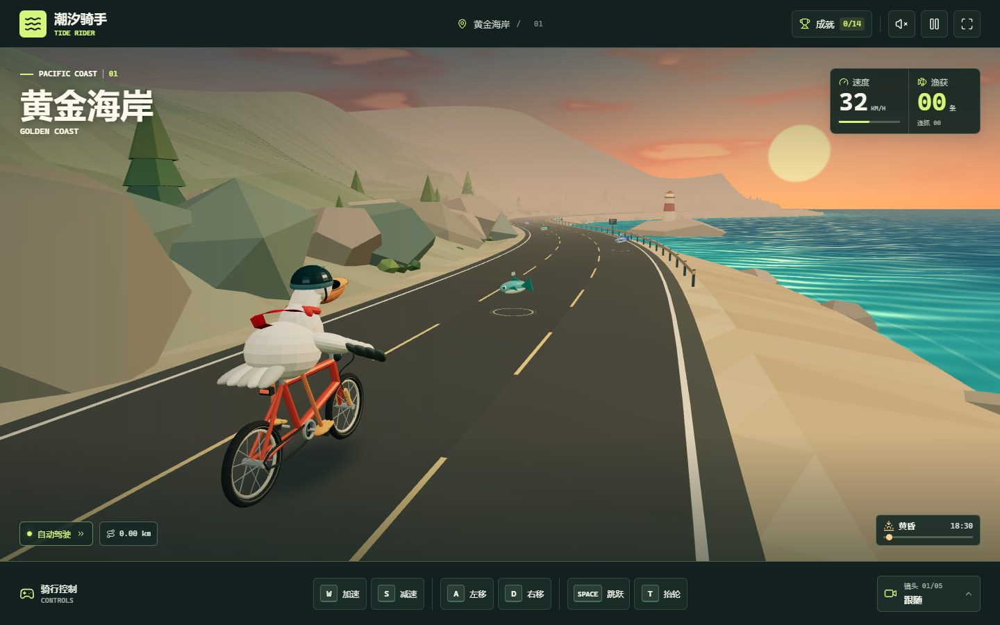

# 潮汐骑手 · Tide Rider

骑着单车沿黄金海岸追鱼的鹈鹕，戴着头盔和墨镜，红围巾随风飘动。

**[▶ 在线试玩](https://sansuitaibai.github.io/tide-rider/)**

无需安装或登录，打开即可游玩。支持电脑键盘和手机触屏。



## 操作

| 按键 | 功能 |
| --- | --- |
| W / S | 加速 / 减速 |
| A / D | 左右变道抓鱼 |
| 空格 | 跳跃 |
| T | 展翅抬起前轮（按住保持） |
| C | 切换镜头 |
| P | 暂停 / 继续 |

不操作约 5 秒后自动驾驶接手，追逐不同车道的鱼；再次操作即可接管。底部有对应的触屏按钮。

## 游戏内容

- 三维海岸公路、低多边形海崖、灯塔、海浪与岸边碎浪。
- 红围巾使用带距离约束和风力的布料物理模拟。
- 从黄昏、星空月夜到黎明的昼夜循环，可拖动时间滑条预览。
- 5 种镜头：跟随、侧面、俯瞰、电影运镜、鹈鹕视角。
- 14 项成就，本机浏览器保存解锁记录。
- Web Audio 实时合成音乐和音效，节拍跟随踏频。点击右上角扬声器开启声音。
- 按帧率调整分辨率与场景距离。

## 本地运行与修改

直接打开根目录的 index.html，即可离线游玩。需要支持 WebGL 的现代浏览器。

src/ 保存游戏源文件。修改后运行：

```sh
npm ci
npm run build
```

构建会生成包含所有脚本和样式的单文件 index.html，无需外部 CDN。

## 发布

GitHub Pages 从 main 分支根目录发布。更新 index.html 并推送后会自动重新发布。

## 第三方组件

Three.js 和 Lucide 使用 MIT 许可证，许可证文本包含在生成的 HTML 中。esbuild 用于构建。
